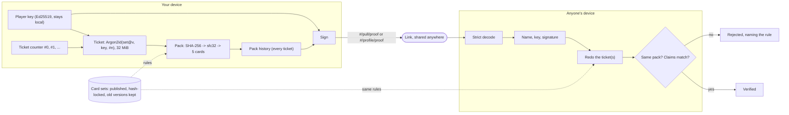

# Architecture

Brainrot TCG is a static site (Vite + React on GitHub Pages) with **no backend**. Every pull is
still verifiable by anyone, because packs are derived from proofs rather than stored anywhere.

## Verification at a glance

No server decides what anyone pulled. Your device does a fixed amount of work per pack and signs the
result; anyone's device redoes the same work from the link and gets the same pack. Opening and
verifying are the same function, `derivePack(set, key, ticket#)`.



GitHub only hosts the site and acts as a public inbox for the Hall of Fame: it could drop a
submission, but every visitor re-checks the entries, so it can't add a fake one. `spec/verify_pull.py`
re-implements all of this from the spec with different libraries, and CI checks both implementations
against both sets of test vectors.

## Layers

```
src/engine/        Pure TypeScript. No React, no DOM, no Vite. Runs in the browser, a Web Worker and Node (CI).
  pack.ts            seeded PRNG + deterministic pack generation (integer-only odds)
  ticket.ts          Argon2id proof-of-work: the cost of one pack
  identity.ts        Ed25519 player keys, fingerprints, name rules
  proof.ts           pull proofs: encode / decode / sign / verify
  scoring.ts         Brainrot Score: rarity points x combo multipliers, all derived from the odds
  odds.ts            exact combo odds for any set (powers the in-game scoring guide)
  hallOfFame.ts      what qualifies for the Hall of Fame (shared by UI and CI)

src/content/       Data. Adding content never needs code changes.
  sets/<set>/set.json  cards (id, name, rarity, caption, flavor, art brief), odds, holo odds
  sets/<set>/art/      source art (real images, full cards, or SVG placeholders)
  sets/<set>/cards/    built card images (npm run cards); committed
  sets/<set>/pack.webp the set's booster pack wrapper, built from its colours and rarest cards
  sets/index.ts        the registry: every version of every set (old versions and archived sets stay for old proofs)
  sets.lock.json       hash of each released set@version (npm run check:sets)

src/game/          Browser glue around the engine.
  player.ts          the local player key, name and ticket counter (localStorage)
  ticketMiner.ts     mines tickets in workers/ticket.worker.ts, pre-mining the next pack
  pulls.ts           openPack(), proofFor(), pullUrl(), checkPull()
  share.ts, bragImage.ts   brag text, Hall of Fame link, 9:16 poster with QR

src/components/    React UI (pack opening, collection, set picker, share sheet, pull viewer, pages)

spec/              The proof spec (PULL_SPEC.md), test vectors, and verify_pull.py: an independent
                   Python verifier written only from the spec. CI runs both verifiers on both vector files.

scripts/           Node tools (run with tsx)
  cards/             card compositor (Genesis frame + art + text), pack wrappers, previews, prompt sheets
  check-sets.ts      set lock guard
  hall-of-fame.ts    verifies Hall of Fame issues; builds public/hall-of-fame.json
```

## How a pull works

```
player key (Ed25519)  ─┐
set@version           ─┼─► Argon2id ticket (≈0.1–0.5 s of work) ─► SHA-256 ─► sfc32 PRNG ─► 5 cards + holos
ticket number (nonce) ─┘
```

- Opening a pack consumes the next ticket number. The ticket is mined in a Web Worker while the
  previous pack is still on screen, so players never wait.
- A **proof** is `(set, version, public key, nonce, name)` signed with the player's key: about 130
  bytes, base64url-encoded into `#/pull/<proof>` links.
- **Verifying** means recomputing the ticket and the pack from the proof. Nothing can be edited:
  changing any byte breaks the signature, and the cards are never part of the proof (they're re-derived).

### Why proof-of-work

Without a server nobody can witness pack openings, so the game can't stop players choosing which
pulls to show. It can make every pull **cost the same as opening a pack**: searching for a lucky
pack is just opening packs. Argon2id is memory-hard, which keeps the advantage of GPUs and big
machines small compared to plain hashing.

Known limits: you can't prove how many packs someone opened in total, or that they weren't using a
bot. A ticket takes about 0.1 s, so a script finds a Full House in seconds and a 5 of a Kind in
minutes of CPU. "Verified" means *these cards really came from this player's ticket*, not that a
person was lucky; the Hall of Fame ranks world firsts by when the GitHub bot verified them for that reason.

A security review (Oct 2026) found and fixed a forgery via small-order Ed25519 keys and malleable
encodings; the rules that close them are in `spec/PULL_SPEC.md` section 7 and covered by the vectors.

## Hall of Fame (no server)

```
player ─► Share ─► "Submit" ─► GitHub issue form (pull link)
                                   │
                    .github/workflows/hall-of-fame.yml
                    scripts/hall-of-fame.ts verify-issue  ─► comment + label (+ redeploy)
                                   │
                    .github/workflows/deploy.yml
                    scripts/hall-of-fame.ts build  ─► public/hall-of-fame.json (re-verified, deduped)
                                   │
                    Hall of Fame page re-derives each entry again in the visitor's browser
```

Issue text is untrusted: it's only parsed by the script, never put into a shell command, and only
echoed back through a sanitiser. The submitter's GitHub username comes from GitHub. "World first"
order uses the time the bot first verified that exact pull on the issue (a marker in its comment), not
the issue's creation date, so a placeholder issue edited later can't claim an earlier spot. Each pull
counts once, however many times it's submitted or re-signed. A maintainer can drop an entry by adding
the `rejected` label to its issue.

## Profiles and levels (no server)

A profile link (`#/profile/<proof>`, spec section 11) is the player's signed list of which set every
ticket went to, from ticket #0 with no gaps, plus two claims: their XP and their five best tickets.
It carries no cards; the viewer re-opens every pack (`src/game/profiles.ts`), so nothing in it can be
edited, and bad packs can't be left out (a ticket's pack is fixed, and every ticket is listed).

Speed, for a profile of N packs (each pack is one ~0.1 s ticket):

- the signature and the claimed level: instant;
- the best pulls: about a second (re-opened first);
- everything: N tickets across a pool of workers (`src/game/ticketPool.ts`, up to 8). If the packs
  don't match the claims, the profile is marked fake;
- a second view, or the same profile with more packs: only the new packs (`src/game/reopenCache.ts`).

The game records every pack the moment it's derived (`src/game/history.ts`), and signs profiles from
that history, so sharing one is instant. Levels come from the packs alone (spec section 11.3), so a
level is exactly as trustworthy as the packs.

## Invariants (CI enforces these)

1. **Released sets never change.** Card ids, order, rarities, odds or pack size of a released
   `set@version` can't change; bump `version` and keep the old file (`npm run check:sets`).
2. **Engine changes that alter packs need a new ticket or proof version.** The engine and the
   independent Python verifier must both pass every vector in `spec/` (`src/engine/spec.test.ts` and
   the `independent-verifier` CI job).
3. **Every card has a built image** (`npm run cards`).

Run everything with `npm run check`.
